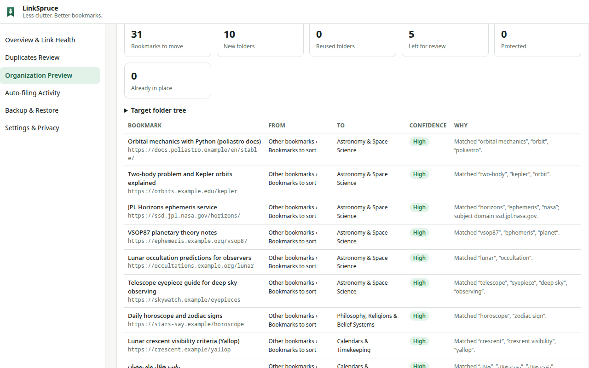

# LinkSpruce — Bookmark Cleaner & Organizer


**Less clutter. Better bookmarks.**

[](https://chromewebstore.google.com/detail/linkspruce/fjcgjgpjfdkafoeelblhdppahkaikbnl)

LinkSpruce is a local-first Chrome extension that finds broken links and duplicate bookmarks, discovers a category structure from **your own** bookmarks, and organizes them — with a preview, a verified backup snapshot and one-click undo for every bulk change. Newly saved bookmarks can be filed automatically once you turn that on.

LinkSpruce has no account, no analytics, no advertising and no developer-controlled server.



## Features

### 🔗 Link health
Check whether bookmarks still work — reachable, redirected, not found, access restricted, rate limited, temporary errors. Polite by design: no cookies, at most 5 requests at a time and one per site. A failed check is never treated as proof a link is dead; removal requires a confirmed recheck and your approval.

### 🧹 Safe duplicate cleanup
Groups identical links, equivalent URLs and tracking-parameter variants (utm_*, fbclid, gclid…). Keeps http/https, www, trailing slashes, anchors and meaningful parameters distinct. Weaker evidence (shared redirects, canonical links) is shown separately and never merged in bulk.

### 🌲 Organize with a structure that fits you
Discovers categories from your bookmarks instead of imposing a fixed list. Rename, merge, split, move, pin or reject categories before anything moves; preview every move; undo the whole batch later. English, Persian and Arabic titles are supported.

### 🤖 Free AI — no key needed
Uses Chrome's built-in on-device AI (Gemini Nano) when your device supports it: free, no account, nothing sent anywhere. Falls back to built-in offline rules otherwise. Gemini cloud AI with your own key is optional and only used after explicit consent and a cost estimate.

### 📥 Auto-file new bookmarks (optional)
Turn it on once and newly saved bookmarks are filed into the right category automatically — creating a category when the subject is clearly new. Ambiguous ones stay where you saved them; every move can be undone.

### 🛟 Backups and recovery
Verified snapshots before bulk changes, JSON backup downloads, restores into a new folder (nothing is overwritten), and a crash-safe operation journal.

## Install

### Chrome Web Store
[Install LinkSpruce from the Chrome Web Store](https://chromewebstore.google.com/detail/linkspruce/fjcgjgpjfdkafoeelblhdppahkaikbnl)

### From source
```bash
npm ci
npm run build        # → dist/
```
Open `chrome://extensions`, enable **Developer mode**, choose **Load unpacked** and select `dist/`. Requires Chrome 134 or later.

## Privacy
Your bookmarks are processed on your device. Data leaves your device only when you start a link check (requests go to the bookmarked websites) or explicitly enable Gemini (selected fields go to Google with your own key). See the [Privacy Policy](PRIVACY.md) and [permissions explained](docs/permissions.md).

## Support
Read the [support guide](SUPPORT.md) and [user guide](docs/user-guide.md), [report a bug](https://github.com/reza-ghazi/linkspruce/issues/new?template=bug_report.yml), or [request a feature](https://github.com/reza-ghazi/linkspruce/issues/new?template=feature_request.yml).

For privacy questions or private correspondence, email [contact@brightarcadia.com](mailto:contact@brightarcadia.com).

## License
[MIT](LICENSE)

---

# For developers

## Develop

| Command | What it does |
| --- | --- |
| `npm run build` / `npm run build:dev` | Production build / dev build with inline source maps |
| `npm run typecheck` | `tsc --noEmit` (strict) |
| `npm run lint` | ESLint (bans `eval`, `innerHTML`, `insertAdjacentHTML`) |
| `npm test` | Vitest unit + integration tests (Node, fakes of chrome.bookmarks/storage) |
| `npx vitest run tests/unit/url.test.ts` | Run one test file (`-t "name"` for one test) |
| `npm run test:e2e` | Builds `dist-e2e/` + `dist/`, runs Playwright E2E in isolated Chromium profiles with a local HTTP fixture server |
| `SCALE=1 npx playwright test tests/e2e/scale.spec.ts` | 25,000-bookmark scale test (slow) |
| `node --experimental-strip-types scripts/perf-node.ts 25000` | Core-algorithm timings on a synthetic 25k library |
| `npm run package` | Audits `dist/` and writes `release/linkspruce-<version>.zip` + SHA-256 checksums |
| `npm run verify` | typecheck → lint → test → build → e2e → package |

E2E uses Playwright's bundled Chromium because branded Chrome 137+ ignores `--load-extension`. The E2E build (`dist-e2e/`) pre-grants only the fixture hostname `*.linkspruce-fixture.example` (mapped to 127.0.0.1) and is never shipped.

## Usage examples

- **Find duplicates offline:** Dashboard → *Duplicates Review*. High-confidence groups (identical URLs, equivalent URLs, tracking-parameter variants) are listed separately from weaker suggestions. Only same-folder copies are preselected; choose which copy to keep, review, confirm.
- **Check links:** *Overview & Link Health* → *Start check*. Grant site access (all sites, or only sites in a folder). 404/410 results must be confirmed by a recheck before removal is offered.
- **Organize:** *Organization Preview* → choose *Discover a new structure* → *Discover structure* → edit the draft (rename/merge/split/move/pin/reject/exclude) → *Approve taxonomy* → *Categorize* → *Build preview* → *Apply changes*. Undo from *Backup & Restore*.
- **Auto-file new bookmarks:** *Settings & Privacy* → *Auto-file new bookmarks* → *Turn on*. Save a bookmark; a few seconds later it moves into, e.g., *LinkSpruce › Astronomy & Space Science › Celestial Mechanics*. Undo or change category from *Auto-filing Activity*.
- **Analyze an exported bookmarks HTML file** without importing it: *Backup & Restore* → *Analyze a bookmarks HTML file*.

## Project layout

```
src/core/        pure logic (URL analysis, audits, jobs, duplicates, taxonomy, classifier,
                 discovery, AI providers, journal, backups, planner, auto-filing, settings)
src/background/  service worker: chrome adapters, orchestration, message handling
src/ui/          popup and dashboard (vanilla TS, text-only rendering)
src/static/      manifest template
tests/unit|integration|e2e   Vitest and Playwright suites; tests/helpers = fakes
scripts/         build, package, icons, perf, local-only private-data analysis
docs/            technical decisions, architecture, permissions, privacy, guides, status
store/           Chrome Web Store listing text and graphics
private/         (git-ignored) private data; never committed or bundled
```

See `docs/architecture.md`, `docs/technical-decisions.md`, `docs/permissions.md`, `docs/user-guide.md`, `docs/recovery.md`, `docs/privacy-policy.md`.

## Reproducible release

```bash
npm ci && npm run verify
sha256sum -c release/linkspruce-$(node -p "require('./package.json').version").zip.sha256
```
